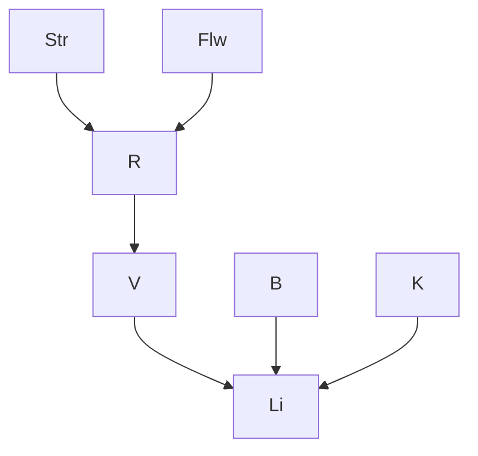

# IA - 2º Trabalho - 1ª Questão

Aluna: Lívia Karolina Gomes do Nascimento

## (a) Rede bayesiana

## (b) CPTs que faltam

P(Str), P(Flw), P(B), P(K), P(R | Str, Flw), P(V | R).
A P(Li | V, B, K) já foi dada no enunciado.

## (c) Valores

- P(Str): dry = 0,6 | wet = 0,3 | snow_covered = 0,1
- P(Flw=t) = 0,05 | P(B=t) = 0,95 | P(K=t) = 0,95
- P(V=t | R=t) = 0,1 | P(V=t | R=f) = 0,9

| Str | Flw | P(R=t) | P(R=f) |
|---|---|---|---|
| dry | f | 0,01 | 0,99 |
| dry | t | 0,30 | 0,70 |
| wet | f | 0,20 | 0,80 |
| wet | t | 0,60 | 0,40 |
| snow_covered | f | 0,40 | 0,60 |
| snow_covered | t | 0,80 | 0,20 |

## (d) Não existe aresta (Str, Li)

O único caminho de Str até Li é Str → R → V → Li. Pelas igualdades do
enunciado, P(V | R, Str) = P(V | R) e P(Li | V, R) = P(Li | V), então Li
depende só de V, B e K. Str não é pai de Li, logo não há aresta (Str, Li).

## (e) P(V | Str = snow_covered)

- P(R=t | snow) = 0,05·0,8 + 0,95·0,4 = **0,42**
- P(R=f | snow) = 1 − 0,42 = **0,58**
- P(V=t | snow) = 0,42·0,1 + 0,58·0,9 = **0,564**
- P(V=f | snow) = 1 − 0,564 = **0,436**
